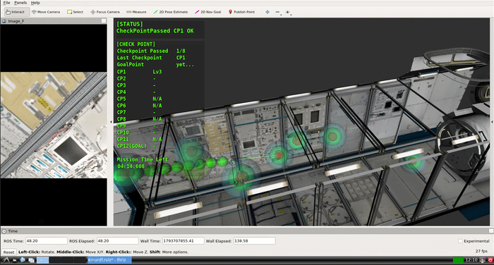
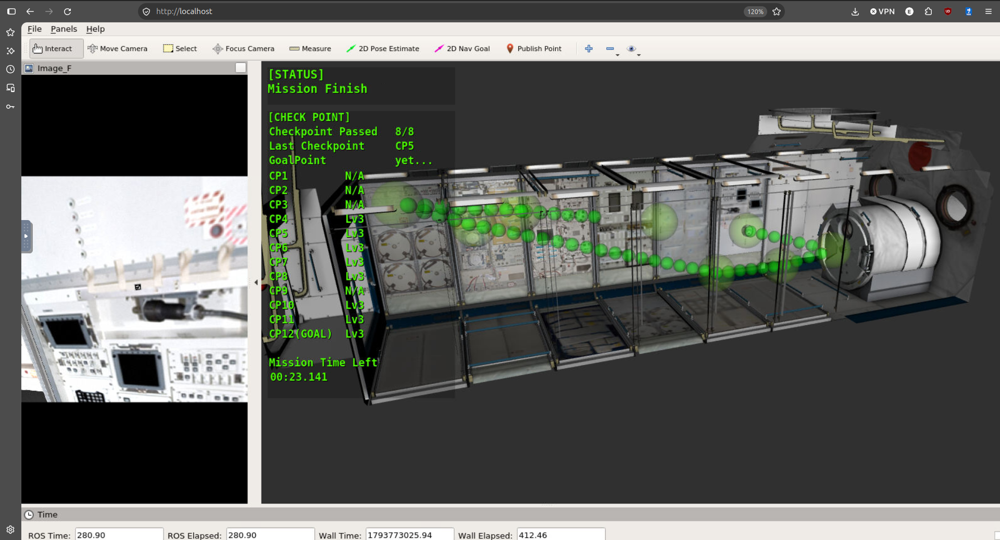
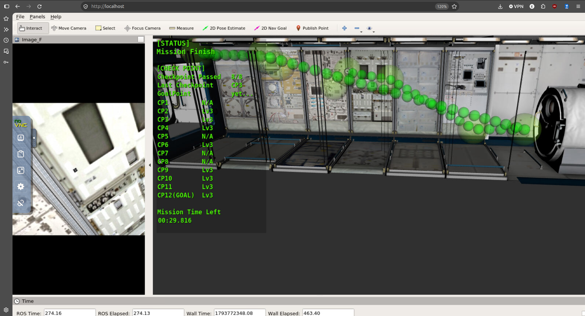

# User Program for JAXA's Int-Ball2 simulator

This is our program for the 7th krpc. The relevant files are inside the  Int-Ball2_Project/catkin_ws/src/krpc_user folder.

# Overview

The movement function and pathfinding algroithms have been from the templat. As of now, a Held-Karp method of traversal is implemented. The current version of the program can reliably traverse all of the targets without the need for course correction. On average, this program can typically finish the course in three an a half minutes - leaving 30 ish seconds to spare.

## Demonstration

Here is a video showing how the Robot moves withing the simultation

Evident in the video, the robot traverses stations in the order that reduces travel distance the most. Instead of traversing by the station IDs or by following a nearest neighbor approach, the robot traverses the stations so that the stations are only visited once, avoiding backtracking and unnecsary cost on travel time

<video controls src="Screencast From 2026-11-04 13-58-47.webm" title="Title"></video>

As seen on the results, the robot can reliably pass and all the stations within the location without the need for backtracking and course corrections.

The function for taking readings and detecting the AR markers are reliable. All 8 stations in every run so far can reliably detect and report the AR markers. However, the sequence of rotations take may be taking too much time. This will be ammended in the next version.

## Technologies used
ROS Melodic (Robot Operating System) – Framework of the robot, used to manage the software components.

Catkin – Build system used to organize and compile ROS packages.

C++11 - Used for scripting and inmplementing the robot functionalities.

Python 3 – Also used for scripting and implementing robot functionalities. But Python.

Ubuntu Linux – Linux-based development environment.

JAXA Int-Ball2 Simulator – Simulation platform used for developing and testing the robot's functionalities.

CMake - Required build config by ROS.

